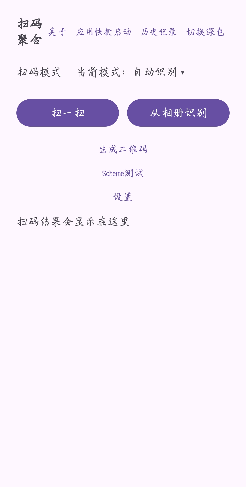
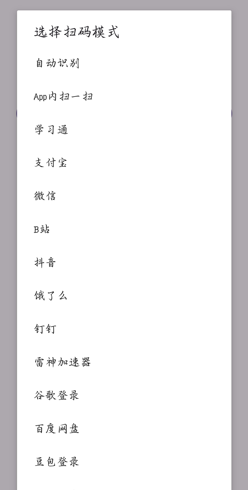
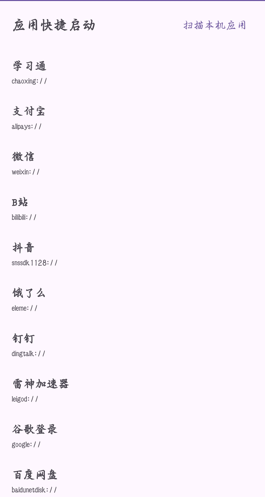
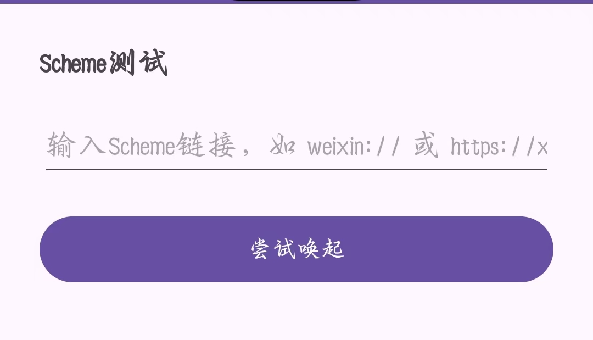

# ScanAggregator | QRCode Aggregate

[简体中文](README.md) | English

A fully offline Android QR code tool: scan with the camera or decode from the gallery → identify the platform with local rules → launch the target app via scheme or copy the link. Supports custom rules, quick app launching, scan history and QR code generation — **no Internet permission at all**.

Current version 1.1.0 · [Download APK (Releases)](https://github.com/Yangxbao/QRCode-Aggregate/releases) · [License MIT](LICENSE)

## Features

- Camera scanning: real-time recognition with ZXingLite, flashlight toggle on the scan page (greyed out on devices without flash, auto-off on exit)
- Gallery decoding: system Photo Picker, no storage permission required
- Scan modes: Auto (rule engine) / Per-app / Scan-inside-app (copy only)
- Quick app launcher: 36 built-in apps + custom apps added by scanning your device; tap to launch, failure opens a debug dialog (copy the scheme)
- Rule engine: rules live in `assets/rules.json` — adding an app requires JSON only, no code changes
- Install detection: package name first with scheme fallback
- QR code generation: text / URL → live preview → save to gallery
- Scan history: auto-saved, keyword search, txt export, long-press menu, multi-select delete
- Result page: content type detection (URL / Wi-Fi / plain text / etc.), copy text, share
- Scheme test page, dark/light theme, About page (version / build time / project link)

## Install (for users)

1. Open the [Releases](https://github.com/Yangxbao/QRCode-Aggregate/releases) page and download the latest `ScanAggregator-vX.X.X.apk`;
2. Tap the APK on your phone and confirm the "unknown sources" prompt;
3. Camera permission is required for scanning; gallery decoding, saving images and exporting history need no storage permission.

## Screenshots

| Home | Scan mode picker |
| --- | --- |
|  |  |

| Quick app launcher | Scheme test |
| --- | --- |
|  |  |

## Build Environment

- Android Studio Ladybug (2024.2.1) or newer
- AGP 8.7.3 / Kotlin 2.0.21 / Gradle 8.9 (downloaded by the wrapper)
- compileSdk 35 / minSdk 24 (Android 7.0)
- A real device is recommended for testing

## Build Instructions (for developers)

1. Clone: `git clone https://github.com/Yangxbao/QRCode-Aggregate.git`
2. Open the project root in Android Studio and wait for Gradle Sync (dependencies download automatically);
3. Connect a device (developer options + USB debugging) and Run 'app';
4. Command line: `gradlew.bat :app:assembleDebug` (Windows) or `./gradlew :app:assembleDebug`; output goes to `app/build/outputs/apk/debug/`;
5. Custom rules: edit `app/src/main/assets/rules.json` (see the format below);
6. After adding a built-in app, declare its scheme and package in the Manifest `<queries>` block.

### Custom rule format (compact style)

```json
{
  "keyword": "weixin.com|wechat.com",
  "tip": "WeChat link detected",
  "appScheme": "weixin://",
  "package": "com.tencent.mm"
}
```

- `keyword`: match keywords, `|` separates multiple entries, contains + ignore case; a `patterns` array is also supported
- `appScheme`: launch URI (same as `target`), supports `{url}` / `{url_encoded}` placeholders
- `package`: app package name, preferred by install detection
- `tip`: message shown on match; the dropdown name is derived from it, or set `name` explicitly
- Rules are matched in array order; the first hit wins

## Scan Modes

The mode selector shows "Current mode: XXX" and opens a dialog (auto-dismisses on tap). Options = **Auto + Scan-inside-app + all apps**:

- **Auto** (default): matches keywords against the rule table and runs the matched action (built-in apps include install detection); unmatched content shows the raw text with a manual platform picker;
- **Per-app (pick an app entry)**: skips keyword matching — scanned content is handled directly by that app's rule: scheme launch (auto-copy on failure) or copy-hint actions;
- **Scan-inside-app**: copies the link only, without binding to any app.

Android (and vendors) do not allow third-party apps to open another app's internal scan page directly; use the copy flow instead.

The scan page has a flashlight toggle (🔦) at the top-right: tap to switch, greyed out on devices without flash, auto-off when leaving the page.

## Quick App Launcher & Scan Installed Apps

The "Quick app launcher" page lists all 36 built-in apps + custom apps; **tap an entry to launch it**:

- **Built-in**: install detection first ("app not detected" toast if missing), then scheme launch;
- **Custom**: launched directly (scheme first, then launch-by-package fallback); on total failure a **debug dialog** shows the app name and scheme with a "Copy scheme" button;
- "Scan installed apps" (top-right) lists launchable apps on the device (requires the `QUERY_ALL_PACKAGES` permission); the 36 built-ins are greyed out, others can be checked to become custom rules —
  `tip` = app label, `appScheme` = heuristic detection (package-segment candidates verified by resolution), `keyword` = `*` (matches everything).

## QR Code Generation

Home → "Generate QR code": type text / URL → tap "Generate" for a live preview (ZXing `QRCodeWriter`, UTF-8) → tap "Save image" to store it in `Pictures/ScanAggregator` (MediaStore without permission on Android 10+, runtime storage permission on older versions); empty input shows a toast and generates nothing.

## Built-in Apps (36 rules)

Rules live in `app/src/main/assets/rules.json`; edit the JSON only. The full list (keyword → scheme → package):

`mobilelearn.chaoxing.com` → `chaoxing://` (com.chaoxing.mobile) · `qr.alipay.com` → `alipays://` (com.eg.android.AlipayGphone) · `weixin.com|wechat.com` → `weixin://` (com.tencent.mm) · `bilibili.com` → `bilibili://` (tv.danmaku.bili) · `douyin.com` → `snssdk1128://` (com.ss.android.ugc.aweme) · `ele.me` → `eleme://` (me.ele) · `dingtalk.com` → `dingtalk://` (com.alibaba.android.rimet) · `leigod.com` → `leigod://` (com.leigod.android.accelerator) · `google.com` → `google://` (com.google.android.googlequicksearchbox) · `pan.baidu.com` → `baidunetdisk://` (com.baidu.netdisk) · `doubao.com` → `doubao://` (com.larus.nova) · `steamcommunity.com|steampowered.com` → `steam://` (com.valvesoftware.android.steam.community) · `qq.com` → `mqq://` (com.tencent.mobileqq) · `xiaohongshu.com` → `xhs://` (com.xingin.xhs) · `zhihu.com` → `zhihu://` (com.zhihu.android) · `music.163.com` → `orpheus://` (com.netease.cloudmusic) · `shturl.cc/` → `alipan://` (com.alicloud.databox) · `taptap.com` → `taptap://` (com.taptap) · `mihoyo.com` → `mihoyobbs://` (com.mihoyo.hyperion) · `kugou.com` → `kugou://` (com.kugou.android) · `kuwo.cn` → `kuwo://` (cn.kuwo.player) · `12306.cn` → `cn.12306://` (com.MobileTicket) · `jd.com` → `jd://` (com.jingdong.app.mall) · `taobao.com` → `taobao://` (com.taobao.taobao) · `pinduoduo.com` → `pinduoduo://` (com.xunmeng.pinduoduo) · `kuaishou.com` → `kwai://` (com.smile.gifmaker) · `sina.com.cn` → `sinaweibo://` (com.sina.weibo) · `xm.com` → `mi://` (com.xiaomi.shop) · `huawei.com` → `huawei://` (com.huawei.appmarket) · `v.qq.com` → `tenvideo://` (com.tencent.qqlive) · `iqiyi.com` → `iqiyi://` (com.qiyi.video) · `youku.com` → `youku://` (com.youku.phone) · `tencent.com` → `txdoc://` (com.tencent.docs) · `feishu.cn` → `lark://` (com.ss.android.lark)

Note: `bilibili.com` and `douyin.com` intentionally appear twice (kept per requirements); auto mode takes the first hit — feel free to de-duplicate.

## Install Detection

Two-step check before launching built-in apps:

1. Package name first (`getPackageInfo`, the most reliable answer);
2. If the package check misses, fall back to scheme resolution (`resolveActivity`) to avoid false negatives;
3. Both miss → toast "app not detected, link copied" and the content is copied; otherwise scheme launch runs, and a failed launch falls back to copy + toast.

Custom rules (added at runtime) skip detection and launch directly: scheme first, then launch-by-package; on total failure the content is copied.

Android 11+ package visibility requires declaring schemes and packages in the Manifest `<queries>` block (all of them are declared); remember to add new ones for new rules.

## History

Every successful scan is saved: content, time, mode, matched app. Stored in SharedPreferences (JSON array), newest first, 100 entries max, fully local.

- Search box filters by keyword in real time;
- Tap an item → copy; long-press → menu (copy / re-process with current mode / delete); re-processing returns home and re-runs the content under the current mode without recording history again;
- "Export" → all records as txt (`Download/ScanAggregator` on Android 10+, app-specific documents dir below);
- "Multi-select" → check multiple items and delete them in one tap; per-item "delete" and "clear all" (with confirmation) are also available.

## Result Page Extras

- Content type detection: URL / Wi-Fi / phone / SMS / e-mail / plain text;
- Persistent "Copy text" button + system "Share" sheet.

## Scheme Test & Settings

- "Scheme test": enter any scheme link (a bare scheme name is auto-completed with `://`) and try to launch it; failures open the unified debug dialog with a copy-scheme button;
- "Settings": auto-copy on successful scan (off by default) and scan beep (off by default); changes apply immediately and persist.

## Theme & About

- "Switch dark / light" at the top-right persists via `ScanApp`;
- The About page shows the version (with versionCode), build time, a GitHub link, the rule count and the project description.

## Known Limitations

- External schemes can only launch an app itself — **opening another app's internal scan page is impossible**; failures auto-copy the link;
- Custom apps (added at runtime) cannot be checked for installation (Android 11+ limitation) and are launched directly;
- Scheme detection for custom apps is heuristic (package-segment candidates verified by resolution); apps without a detectable scheme only support the copy flow;
- `QUERY_ALL_PACKAGES` powers "Scan installed apps" and needs justification if published on Google Play.

## FAQ

**Q: Why does nothing happen when I tap some apps, or why does the launch fail?**
A: Usually vendor restrictions or the app does not register that scheme handler. Copy the scheme from the failure dialog, or use the copy flow and paste inside the app.

**Q: Can it open another app's internal scan page?**
A: No. Android offers no public way to do that across apps.

**Q: It says "app not detected" but the app is installed.**
A: The built-in rule's package name may differ on your app version — fix the `package` field for that entry in `rules.json`. Detection also falls back to scheme resolution, so this is rare.

**Q: Why is there no scheme for some apps in "Scan installed apps"?**
A: Public APIs cannot enumerate the schemes an app registers; detection is heuristic. You can edit the stored rules or wait for a shared scheme mapping table.

**Q: Where are generated QR images and exported history stored?**
A: Images in `Pictures/ScanAggregator`; history exports in `Download/ScanAggregator` (Android 10+).

**Q: Why is there no Internet permission?**
A: By design — recognition, rules and history are all local.

**Q: Gradle Sync complains about the JDK version?**
A: Gradle 8.9 runs on JDK 17–22. If your system JDK is newer (e.g. 25), point the Gradle JDK in Android Studio settings to the bundled JBR or a JDK 17/21.

## Changelog

### v1.1.0 (2026-10-11)
- Persistent "Copy text" on the result page; settings for auto-copy on scan and scan beep
- History: keyword search, txt export, multi-select delete
- New "Scheme test" page; About page with version, build time and project link
- Install detection upgraded: package name first + scheme fallback; custom apps fall back to launch-by-package

### v1.0.0
- UI restructure: scan modes separated from the quick app launcher; slimmer mode dropdown
- Flashlight toggle on the scan page (greyed out without flash, auto-off on exit)
- New "Generate QR code": text/URL preview saved to the gallery
- Debug dialog for failed launches (shows the scheme, copy supported)

### v0.9.x
- Quick launch in the dropdown: tapping "XX - Launch app" starts the app immediately
- "Scan installed apps" to add custom apps by checkbox (wildcard keyword, heuristic scheme detection)
- Install detection upgraded: package name first + scheme fallback; launch-by-package fallback for custom apps

### v0.8.0
- Per-app entries split into "Launch app / Scan inside app"; 20 more built-in apps (36 total)
- History long-press menu, result sharing, dark/light theme, About page, content type detection

### v0.7.0
- Rule engine with a standalone rules.json, install detection, scan history, gallery decoding

## License

[MIT](LICENSE)
